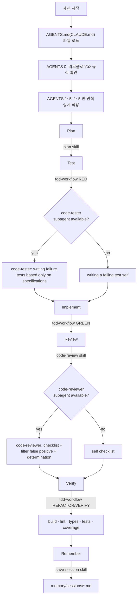

# My Harness

여러 코딩 프로젝트에 재사용할 수 있는 커스텀 하네스. Claude Code, Codex, Cursor에 같은 행동 지침(`AGENTS.md`)과 `skill`·`rule`·`sub-agent`·`workflow`를 설치한다.

## 📜 Reference

- [affaan-m/ECC](https://github.com/affaan-m/ECC)
- [multica-ai/andrej-karpathy-skills](https://github.com/multica-ai/andrej-karpathy-skills)
- [emilkowalski/skills](https://github.com/emilkowalski/skills), [leonxlnx/taste-skill](https://github.com/leonxlnx/taste-skill), [pbakaus/impeccable](https://github.com/pbakaus/impeccable) — `design-taste`/`ui-consistency-audit` 스킬의 아이디어 출처 (CLI·이미지 생성·GSAP 등 무거운 도구 체인은 제외하고 규칙만 이식)

## 🪄 Install

```bash
# 로컬 — 현재 프로젝트에만 설치
npx github:jae-yon/my-harness <codex|claude|cursor>

# 전역 — 홈 디렉터리에 설치, 모든 프로젝트에 자동 적용
npx github:jae-yon/my-harness <codex|claude|cursor> --global
```
> [!NOTE]
> 이미 설치된 대상이 있으면 대화형 터미널에서는 덮어쓸지 물어보고(Y/N), 비대화형 환경에서는 자동으로 건너뛴다.

| 플랫폼         | 로컬 설치 위치                                                  | 전역 설치 위치                                                                    |
| ----------- | --------------------------------------------------------- | --------------------------------------------------------------------------- |
| Codex       | `.agents/{skills,rules,agents,workflow.md}` + `AGENTS.md` | `~/.codex/{skills,rules,agents,workflow.md,AGENTS.md}`                      |
| Claude Code | `.claude/{skills,rules,agents,workflow.md}` + `CLAUDE.md` | `~/.claude/{skills,rules,agents,workflow.md,CLAUDE.md}`                     |
| Cursor      | `.cursor/{skills,rules,agents,workflow.md}` + `AGENTS.md` | `~/.cursor/{skills,rules,agents,workflow.md}` + `~/.cursor/rules/AGENTS.md` |

> [!WARNING]
> - Cursor의 전역 규칙은 공식적으로 `.mdc` 확장자를 기대한다. 지금은 `.md`로 설치되므로 실제 인식 여부는 별도 확인이 필요하다.
> - `agents/`(서브에이전트 정의)는 Claude Code의 `.claude/agents/*.md`가 실제 네이티브 컨벤션과 일치하여 그대로 서브에이전트로 동작하지만, Codex와 Cursor는 동일한 네이티브 지원 여부가 아직 미확인 상태이다. (설치 시 안내 문구 출력)


## 🏗️ Structure

```
package.json (bin: my-harness)
        ↓
bin/cli.js
        ↓
target/{platform}.js
```

- `core/`: 플랫폼과 무관한 공통 구성 요소 (`/skills`, `/rules`, `/agents`, `workflow.md`)
- `target/*.js`: 구성 요소를 각 플랫폼이 인식하는 위치·이름으로 옮기는 어댑터
- `AGENTS.md`: 정본 하나를 Claude Code에는 `CLAUDE.md`로, Codex/Cursor에는 `AGENTS.md` 그대로 배포한다. `{{HARNESS_DIR}}`가 설치 시점에 실제 경로(`.claude`, `.agents`, `.codex` 등)로 치환된다.
- `*.kr.md`: 한국어 초안·미러 파일(예: `coding-style.kr.md`, `code-reviewer.kr.md`). 실제로 따르는 정본은 항상 영어 `.md` 쪽이며, `.kr.md`는 사용자의 이해의 편의성을 돕기 위한 목적이기에 설치과정에서 자동으로 제외된다.


## ✨ Components


#### Workflow (`core/workflow.md`)

`Plan → Test → Implement → Review → Verify → Remember`

#### Skills (`core/skills/`)

- `plan` — 코드를 쓰기 전 구현 계획 수립 (단계별 검증 방법까지 명시)
- `tdd-workflow` — RED → GREEN → REFACTOR 강제. RED는 가능하면 `code-tester` 서브에이전트에 위임
- `code-review` — 구현 직후 점검. 가능하면 `code-reviewer` 서브에이전트에 위임(모델 우선순위: Opus 5 → Opus 4.8 → 세션 상속), 서브에이전트 불가 환경용 대체 체크리스트 포함
- `save-session` — 긴 세션 종료 시 요약을 `memory/sessions/`에 저장 (프로젝트 루트 기준, `.gitignore` 권장)
- `design-taste` — 프론트엔드 UI 작성/스타일링 시 사용. 완전히 새로운 페이지/화면이면 브라우저/WebSearch로 Mobbin·Dribbble 레퍼런스부터 조회하고, 새 값을 지어내기 전에 기존 디자인 토큰(Tailwind/shadcn)을 재사용하도록 하며, 간격·타이포그래피·색상·radius·모션·반응형(모바일 퍼스트, breakpoint 스케일 재사용) 기본 규칙을 적용 (workflow 다이어그램과 무관한 상황별 스킬)
- `ui-consistency-audit` — 컴포넌트를 하나씩 늘려오며 쌓인 디자인 드리프트를 점검. 파일별이 아니라 패턴별로 보고하고, 대량 수정 전 확인을 받음 (workflow 다이어그램과 무관한 상황별 스킬)


#### SubAgents (`core/agents/`)

Claude Code의 `.claude/agents/*.md` 컨벤션. 스킬보다 무거운 로직(체크리스트, 신뢰도 기반 필터링, 흔한 거짓양성 스킵 리스트, 판정 기준)을 담당

- `code-reviewer` — 코드를 작성한 기억이 없는 새 컨텍스트에서 리뷰. Approve/Needs changes/Blocked로 판정
- `code-tester` — 구현을 보지 않고 스펙·인터페이스만으로 실패하는 테스트를 작성 (구현에 맞춰 테스트를 짜맞추는 편향 방지)
- `design-reviewer` — UI/프론트엔드 변경을 웹디자이너·웹퍼블리셔 관점에서 리뷰(토큰 일관성, 비주얼 테이스트, 마크업 시맨틱, 접근성, 모바일/태블릿/데스크탑 반응형 — 브라우저 도구 있으면 실제 리사이즈, 없으면 정적 추론 후 명시). `design-taste`/`ui-consistency-audit` 스킬이 가능하면 여기로 위임. Approve/Needs changes/Blocked로 판정


#### Rules (`core/rules/`)

- `coding-style.md` — 네이밍(DB는 snake_case 포함)·들여쓰기·중괄호·줄 길이·주석·코드 구조·포매팅
- `git-workflow.md` — 브랜치 전략(Git Flow: main/develop/feature/release/hotfix), 커밋 컨벤션, 머지 전 체크


## 🚀 Flowchart




- `rules/`(coding-style, git-workflow)는 다이어그램의 한 단계가 아니라, Implement·Review 내내 배경처럼 적용되는 제약이다.
- 서브에이전트(`code-tester`, `code-reviewer`)가 없는 플랫폼(Codex/Cursor는 아직 미확인)에서는 스킬에 적힌 대체 절차로 자연스럽게 폴백된다.


## 🧪 Local Test

```bash
npm run test:claude   # test:codex, test:cursor도 동일
```

`.sandbox/`(gitignore 처리됨)에 격리해서 설치하므로 본 저장소에 직접 설치되지 않는다.

## ✅ TODO

- [ ] `core/skills`, `core/rules`, `core/agents` 콘텐츠를 실제 작업에 적용해보고 다듬기
- [ ] Cursor 전역 설치의 `.mdc` 확장자 대응 검증
- [ ] Codex/Cursor의 네이티브 서브에이전트 지원 여부 확인
- [ ] 플랫폼별 스킬 선택 설치 (지금은 `core/skills` 전체가 모든 플랫폼에 동일하게 설치됨)